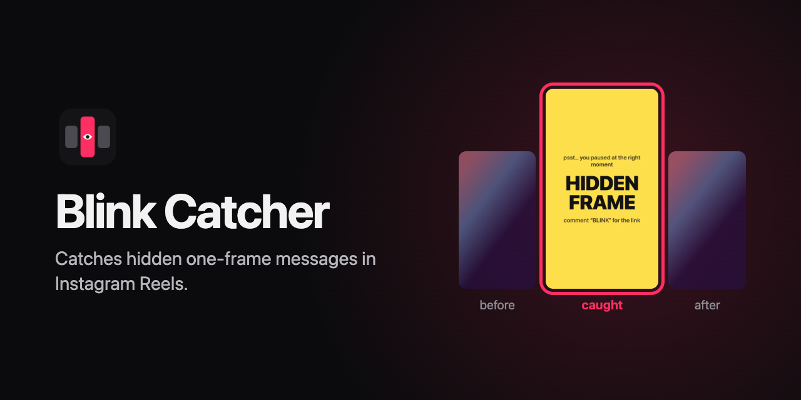
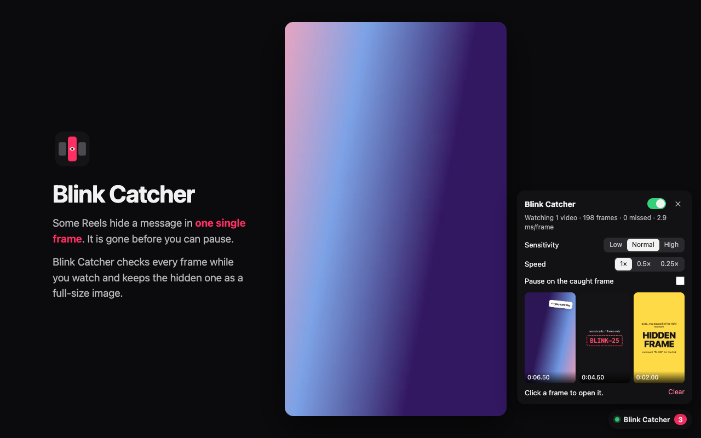
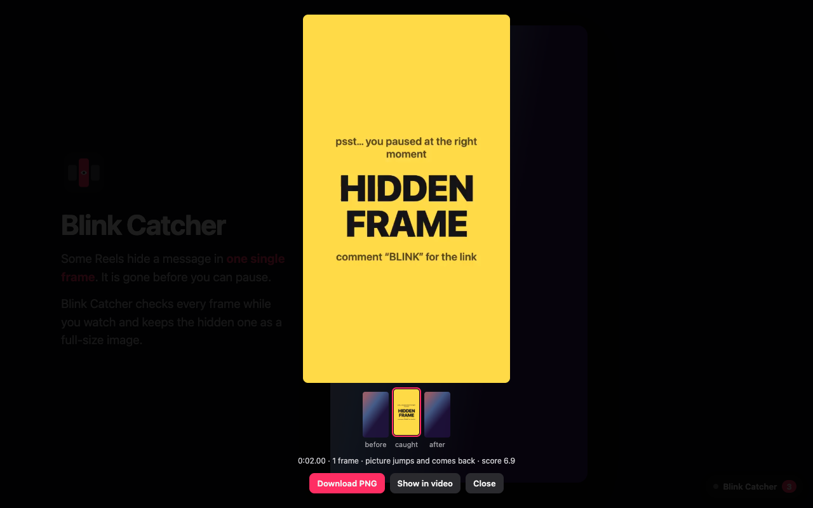

# Blink Catcher



Chrome extension (Manifest V3) that catches 1–3 frame inserts in Instagram Reels — hidden
messages, "25th frame" tricks — and keeps each one as a full-size PNG, so you never have to
pause on the exact frame by hand.

## Install

**From a release**

1. Download `blink-catcher-<version>.zip` from [Releases](https://github.com/angelus169/blink-catcher/releases) and unzip it.
2. Open `chrome://extensions/` and turn on **Developer mode**.
3. Click **Load unpacked** and select the unzipped folder.

**From source:** clone the repo and load its root folder the same way. After a code change, click
**Reload** on the extension card and refresh the Instagram tab.

Open a Reel. A **Blink Catcher** pill shows in the bottom-right corner.

## Use



- The red counter on the pill counts catches. Click the pill to open the panel.
- The switch at the top of the panel turns checking on or off. Chrome remembers the choice;
  when it is off, the pill is dimmed and videos play without any extra work.
- Click a catch to see it full size, with the frames before and after it.
  **Download PNG** saves it; **Show in video** pauses the Reel on that frame.
- **Pause on the caught frame** stops the video on each new catch.
- **Sensitivity**: use **High** for faint inserts; use **Low** if normal edits get caught.
- **Speed 0.5× / 0.25×**: use it when the status line shows missed frames.



## How it works

- `content.js` follows every playing `<video>` with `requestVideoFrameCallback`, copies each frame
  to a canvas (last 5 kept full size) and gives a 36×64 thumbnail to the detector.
- `detector.js` splits the thumbnail into a 4×8 grid and checks the last few frames for a run of
  1–3 frames that is either:
  - **flash**: part of the picture jumps away and comes back (frame before ≈ frame after), or
  - **cut**: its own tiny shot between two hard cuts.
- A motion guard raises the thresholds in strobe-like or very fast footage.
- Catches live in memory for the tab (max 50); nothing leaves the browser. See [PRIVACY.md](PRIVACY.md).

## Limits

- It sees only the frames Chrome shows. A busy CPU can drop the one frame that matters
  (the status line counts missed frames). Reels loop, so the next pass often catches it.
- Flashes, strobe effects and glitch transitions can be caught too.
- A DRM-protected video gives black pixels; the pill dot turns red.

## Develop

```sh
node --test test/*.test.js           # detector unit tests (synthetic frames)
./test/make-test-video.sh            # builds test/blink.mp4 with known inserts (needs ffmpeg)
python3 -m http.server 8765          # then open http://localhost:8765/test/
node store/make-assets.mjs           # icons, demo video, screenshots, promo tile, social preview
./scripts/build-zip.sh               # dist/blink-catcher-<version>.zip for releases and the store
```

The test page loads the same two scripts as the extension and lists the expected catches.
`store/make-assets.mjs` runs the extension code in headless Chrome on a demo video and fails if a
hidden frame is not caught. Chrome Web Store texts are in [store/listing.md](store/listing.md).

## License

[MIT](LICENSE)
